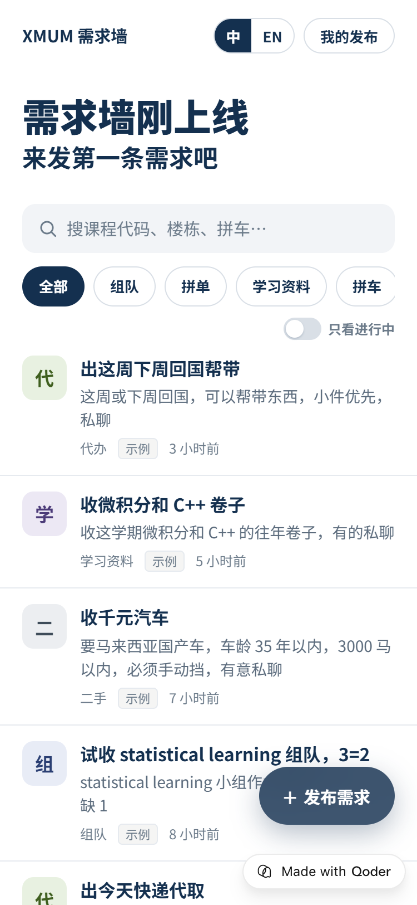
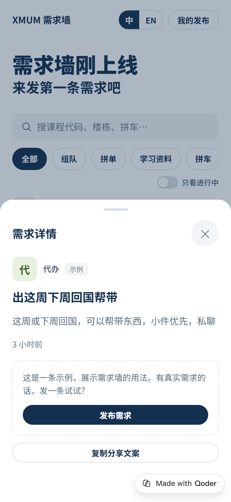
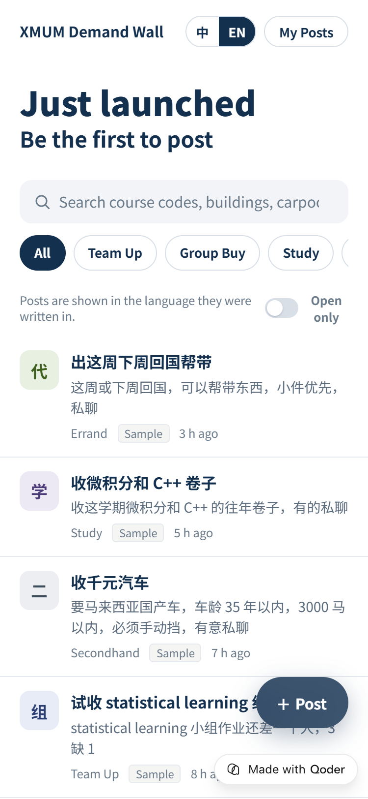

# XMUM 校园需求墙

XMUM Demand Wall is an anonymous mutual-help board for students of Xiamen University Malaysia (XMUM). Post a need — teaming up for a contest, group buys, study materials, carpool, housing, secondhand items or small errands — and classmates can reply with "I can help" to reveal your contact. No sign-up, no app install: it is a mobile-first web page in Chinese and English, built with Qoder and hosted on Qoder Sites.

厦马学生的互助需求墙：发一条需求，同学点「我能帮」就能看到联系方式。匿名、免注册、中英双语，手机浏览器打开即用。

**线上地址：<https://xmum-wall-eq2inghso5q.qoder.zone>**

| 首页 | 示例帖详情 | 英文模式 |
| --- | --- | --- |
|  |  |  |

## 痛点

厦马中国学生的互助需求散落在各个 QQ 群和微信群里：拼车、拼单、求卷子、二手转让……消息发出去几分钟就被刷下去，需要的人看不到，想帮的人找不到。群聊没有分类、没有搜索、没有沉淀，同一个问题每周都有人再问一遍。

需求墙把这些需求从群聊里捞出来，放在一个有分类、可搜索、能沉淀的公开页面上，让「发需求」和「能帮忙」两边都能低成本地找到彼此。

## 核心功能

- **7 个分类**：组队、拼单、学习资料、拼车、住宿、二手、代办。分类栏一键筛选，发布时按分类给出对应的描述提示（如组队提示填写比赛/课程名称、还差几人、你能做什么）。
- **搜索**：按标题和描述关键词即时过滤，配合分类与「只看进行中」开关。
- **我能帮**：详情页点击「我能帮，看联系方式」才展示联系方式，同时该需求的「能帮人数」+1；联系方式下方附安全提示「交易前当面确认，别提前转账」。
- **回复与私信**：详情页下方可以匿名回复，按时间正序显示，标注「匿名同学」或「发布者」及相对时间；勾选「仅发帖人可见」即为私信，只有发帖人（本机「我的发布」里存有该帖凭据）能看到。回复最多 200 字，每设备每分钟 5 条、每小时 30 条；每条回复可低调举报，被 3 个不同设备举报后自动隐藏。示例帖不开放回复。
- **联系方式选填**：发布时可以不留联系方式。没留的需求不显示「我能帮，看联系方式」，改为提示「发帖人没留联系方式，可以发私信给 TA」并默认勾选私信。
- **我的发布·私信**：每条需求显示私信数量，点开可查看私信列表，并以「发布者」身份公开回复。
- **4 位数字口令**：发布时自己设置一个 4 位数字口令（必填，输入时遮蔽显示）。换了浏览器或手机，在帖子详情页底部点低调的「我是发帖人」，输入口令即可把这条需求加回本机「我的发布」，继续改状态（进行中/已接单/已完成）或撤下。
- **管理凭据不再展示**：发布时服务端仍生成 manage_token，前端只把它存进本机「我的发布」，不再展示给用户、也没有「复制管理码」按钮——之前同学看不懂 UUID 管理码，还有人把它直接发到群里。口令功能上线前发的旧帖没有口令，可在「我的发布」里用次要入口「旧帖子用管理码找回」。
- **撤下**：需求解决后一键撤下，页内确认层防误触；撤下后列表与详情均不可见。
- **复制分享文案与深链接**：一键复制带链接的分享文案（`/#/d/<id>` 深链接直达详情），方便转回 QQ/微信群；剪贴板不可用时有手动复制兜底。
- **中英双语**：界面一键切换，帖子按撰写语言原样展示；英文模式附说明提示。
- **举报自动隐藏**：同一需求或回复被 3 个不同设备举报后自动隐藏，等待管理员处理；同设备重复举报无效。
- **管理后台**：管理员凭密钥查看举报、恢复误隐藏的需求、删除违规需求或回复、批量清理示例帖。
- **示例帖标识**：上线初期的示例内容带灰色「示例」标签，不展示能帮人数、不可举报、不计入开场统计，详情页引导用户发布真实需求；真实帖为 0 时开场区显示「需求墙刚上线 / 来发第一条需求吧」。

## 设计

- **「已接单」撕角**：被接单的需求卡片右上角做撕角效果，露出「已接单」标签。全站唯一的高饱和暖色 `#C4541D` 只用在这里——状态变化是信息流里最重要的事件，值得唯一的视觉重音。
- **玻璃浮层顶栏**：向下滚过开场区后，顶部浮出毛玻璃栏（品牌 + 搜索 + 分类 + 我的发布），筛选能力始终在手边，又不占用首屏空间。
- **单字印章**：每个分类一枚单字圆角印章（组/拼/学/车/住/二/代），低饱和底色 + 同色系深字，扫一眼就能区分分类，也避免了图标库的体积与风格成本。
- **配色取自厦马校园的「红顶白墙」**：纯白底与浅灰分隔线取自白墙，正文用深瓦蓝 `#14304F` 保证对比度，红顶的暖色只留给撕角一处。整体克制、安静，让内容本身成为主角。
- **移动优先**：375px 宽度下完成全部流程；弹窗为底部弹层（sheet），悬浮发布胶囊常驻右下。

## 安全与合规

- **联系方式按需获取**：列表与详情接口永不返回联系方式和管理码；联系方式只通过独立的 `/contact` 与 `/help` 接口按需返回，并按设备令牌限流（查看联系方式 20 次/分钟、我能帮 30 次/分钟、发布 5 条/10 分钟、回复 5 条/分钟且 30 条/小时、举报 20 次/分钟），防止被脚本批量爬取。
- **私信只给发帖人**：公开回复接口永不返回私信；私信列表接口必须携带正确的 manage_token，带错误凭据回复会被拒绝，发布者身份只由服务端比对 manage_token 认定。
- **管理凭据机制**：撤下、改状态、看私信必须携带 manage_token，服务端比对后才执行；manage_token 只存用户本机，服务端不留会话、不做账号体系。它只在两处返回：发布响应，以及口令认领成功。
- **口令只存加盐哈希**：`pin_hash = SHA-256(需求 id + 口令 + PIN_PEPPER)`，库里不存明文口令；`PIN_PEPPER` 是服务端 Secret 环境变量，不进代码和数据库，即使数据库泄露也无法离线穷举 4 位口令。未配置 `PIN_PEPPER` 时发布与认领一律返回 503，绝不退化成无密钥哈希。口令哈希、失败次数、锁定时间从不返回给前端。
- **口令防暴力**：认领接口 `POST /api/demands/:id/claim-pin` 有两层限制——按设备每分钟 10 次；按需求累计错 5 次锁定 1 小时（`pin_locked_until`，存数据库，跨实例生效），锁定期间一律返回 429。失败次数只在认领成功时清零，所以锁定到期后再错一次会立即重新锁 1 小时。每次尝试先用条件更新（`pin_fail_count` 仍等于读到的值）占用一次计数再比对口令，并发请求无法共用同一个计数多试几次。格式不对（不是 4 位数字）直接 400，不计入失败次数；旧帖没有口令返回 409 `pin_not_set`。
- **服务端校验**：分类白名单、标题/描述/联系方式/回复长度上限、状态枚举、UUID 格式全部在服务端校验，前端校验只是体验优化；所有写入经过限流与输入清洗。
- **防 XSS**：用户内容一律以 `textContent` 渲染，不拼接 HTML；分享文案等动态文本同样走文本节点，杜绝存储型 XSS。
- **主动不承接换汇**：换汇涉及外汇管制与洗钱合规风险，也是校园诈骗高发场景，本站从分类白名单到服务端校验都明确拒绝换汇类需求，并在发布表单提示「换汇请走银行等正规渠道」。不做，比做了再治理更负责。
- **匿名设计的取舍**：免注册把发布门槛降到最低，代价是无法追责到人。补偿手段是设备令牌去重 + 限流 + 举报自动隐藏 + 管理员处置，把滥用控制在「可治理」而非「可追溯」；本机凭据 + 发帖人自设的口令把「谁能改这条帖子」绑定到发帖人本人知道的东西，而不是绑定到身份。
- **密钥管理**：管理员密钥 `ADMIN_KEY` 与口令哈希密钥 `PIN_PEPPER` 都通过平台 Secret 环境变量注入，只存在于服务端运行时，不进入代码与仓库。`PIN_PEPPER` 一旦设置就不要更换，否则所有已存口令都会失效（只能改用管理码或重新发布）。

## 技术架构

- **托管**：[Qoder Sites](https://qoder.com) 静态托管 `dist/` 前端产物，公开访问，自带 HTTPS。
- **数据库**：Qoder Sites 自带 PostgreSQL 数据库（`app` schema），表结构变更只走平台 migration 流程；业务表为 `demands`（需求）、`reports`（举报）、`replies`（回复与私信）与 `reply_reports`（回复举报去重）；迁移文件放在 `migrations/`。
- **Server Functions**：Deno Edge Function 承载全部业务接口（`/functions/v1/app` 同源调用）。入口 `functions/index.ts` 负责装配，业务逻辑集中在 `functions/routes.mjs`（纯函数式 `application({ db, BackendError, env })`，便于本地注入假数据库测试）。
- **平台运行时模块**：`functions/_qoder/backend.mjs`（提供 `createDatabaseClient` / `createSiteContext` / `errorResponse` / `BackendError`）由 Qoder Sites 运行时在部署时注入，**不在本仓库中**，因此 `index.ts` 无法在本地直接运行；本地测试只导入 `routes.mjs`。
- **前端**：原生 HTML/CSS/JavaScript，无构建步骤、无框架依赖；中英双语字典、LocalStorage 存本机发帖凭据与去重集合、hash 路由支持详情深链接。

## 目录结构

```
.
├── dist/                  # 前端产物（Qoder Sites 静态托管目录）
│   ├── index.html         # 页面结构：信息流 / 玻璃浮层 / 各弹窗 / 管理页容器
│   ├── styles.css         # 设计令牌 + 全部组件样式
│   ├── app.js             # 渲染、双语、路由、接口调用、本地存储
│   └── favicon.svg
├── functions/             # Server Functions（Deno Edge）
│   ├── index.ts           # 入口：装配平台运行时与业务路由
│   └── routes.mjs         # 全部业务接口与校验、限流逻辑
├── dev/
│   └── test.mjs           # 本地逻辑测试（内存假数据库，209 项断言）
├── docs/screenshots/      # 线上 375px 截图
├── migrations/            # 平台 migration 文件
├── schema.sql             # 表结构参考（实际变更走平台 migration）
├── README.md
├── LICENSE
└── .gitignore
```

## 本地运行与测试

无需安装依赖（Node.js ≥ 18）：

```bash
node dev/test.mjs
```

测试向 `routes.mjs` 注入内存假数据库与假环境变量（含测试用 `PIN_PEPPER`），覆盖发布校验、管理凭据权限、联系方式按需返回、限流、举报自动隐藏、管理员处置、示例帖规则、回复/私信/回复举报与回复限流，以及 4 位口令的格式校验、哈希存储、认领正确/错误、累计 5 次锁定 1 小时、并发计数、旧帖没有口令、按设备限流、未配置密钥等 209 项断言。它验证的是路由业务逻辑，不代表云端数据库与入口隔离已验收。

前端为纯静态文件，任意静态服务器即可预览（如 `npx serve dist`）；接口需部署到 Qoder Sites 后才可用。

### 部署口令功能前

1. 在 Qoder Sites 的 Secret 环境变量里新增 `PIN_PEPPER`（一串足够长的随机字符串，例如 `openssl rand -hex 32` 的输出）。**先配好再部署**，否则发布需求会返回 503。
2. 执行 migration `migrations/20261120000000_add_demand_pin.sql`（给 `demands` 加 `pin_hash`、`pin_fail_count`、`pin_locked_until` 三列，均可为空）。

## 未来规划

- **厦马学校邮箱验证**：以学校邮箱做轻量身份校验，在匿名与可追溯之间取得更好平衡。
- **图片上传**：二手、住宿等分类支持配图，信息更完整。
- **微信小程序**：覆盖微信内场景，分享与回流更顺。

## 声明

本项目使用 [Qoder](https://qoder.com) 开发，参加 **Qoder 2026 创新大赛 LifeHack 赛道**。

## 致谢

Logo 与启动动画字形来自开源字体 Anton（SIL Open Font License 1.1）。

## License

[MIT](LICENSE) © 2026 Lan Haotian